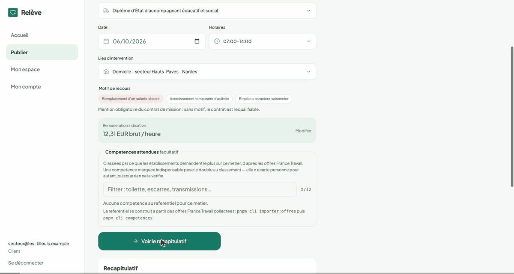
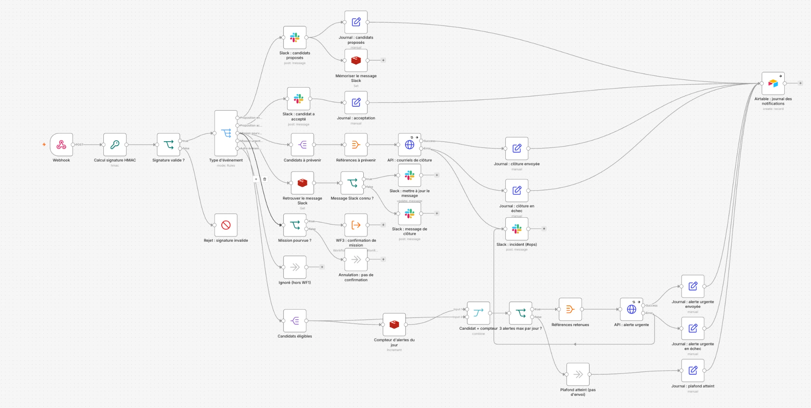
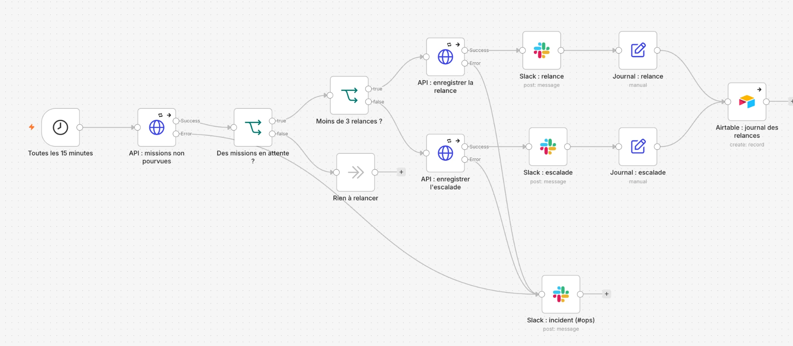
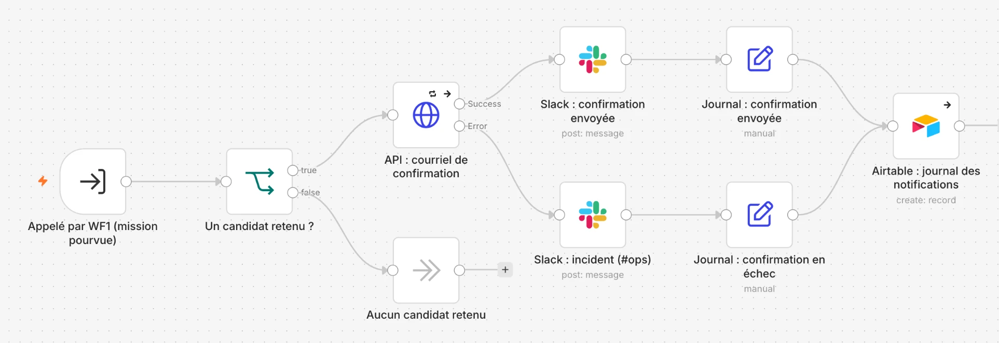
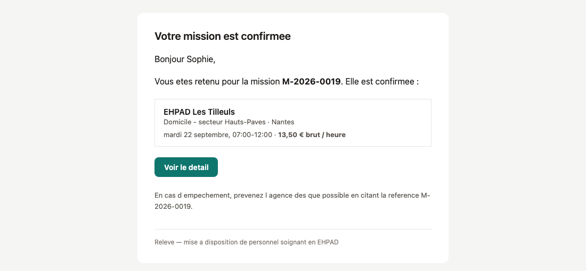

# 🩺 Relève — L'intérim des aides-soignants, enfin outillé

<div align="center">

[](https://nestjs.com/)
[](https://nuxt.com/)
[](https://www.postgresql.org/)
[](https://n8n.io/)
[](https://airtable.com/)
[](https://www.epitech.eu/)

**Une mission urgente ne dort plus dans un planning : la bonne personne est prévenue, au bon moment, sans qu'aucun nom ne sorte vers un service tiers.**

[▶️ Démo](#️-démo) · [🔁 Workflows n8n](n8n/README.md) · [📡 Contrat d'événements](docs/automatisations.md) · [📘 Documentation technique](docs/README-technique.md) · [📂 Livrables](livrables/)

</div>

---

## ▶️ Démo

<div align="center"></div>

*Parcours réel enregistré en local : publication urgente → alerte e-mail (WF1) → candidature → Slack de l'agence → confirmation par l'EHPAD → e-mail de confirmation (WF3) → cockpit Airtable.*

---

## 🎯 Contexte & problème

Il est **six heures trente**. Un aide-soignant se déclare malade. À sept heures, quarante résidents attendent le lever. Le cadre de santé va passer l'heure qui vient au téléphone, à chercher quelqu'un de qualifié, disponible et **légalement autorisé** à prendre la mission.

| Chiffre | Source |
|---|---|
| **62 000** projets de recrutement d'aides-soignants en 2026 | France Travail |
| **60 000** postes vacants de soignants en EHPAD | FNADEPA |
| **825 M€** d'intérim paramédical, **830 000 missions** de 2,3 jours en moyenne | Cour des comptes, 2023 |

Une contrainte légale que personne n'outille, la **loi Valletoux** : depuis le 1er juillet 2024, deux ans d'exercice hors intérim (**3 214 heures**) avant une première mission. La vérification incombe à l'agence d'intérim.

---

## 💡 La solution

Une **agence d'intérim numérique** qui apporte aux EHPAD, cliniques et hôpitaux un vivier d'aides-soignants déjà vérifiés :

1. **L'établissement publie** son besoin (poste, lieu, horaires, motif de recours obligatoire).
2. **La plateforme filtre et classe** : diplôme, distance (PostGIS), disponibilités, contrôle Valletoux. Chaque décision est explicable.
3. **Les automatisations préviennent** les bons profils, relancent les missions oubliées et confirment par écrit.
4. **L'établissement valide**, et la mission est pourvue.

---

## 🧑‍💻 Mon rôle — Data analyst, automatisation de bout en bout

> Rien n'existait côté automatisation au démarrage du projet : j'ai conçu, construit, testé et présenté toute la chaîne.

- **Contrat d'événements** entre l'API et n8n : événements, format, signature, pseudonymisation → [`docs/automatisations.md`](docs/automatisations.md)
- **3 workflows n8n** (57 nœuds), publiés et testés sur de vraies missions → [`n8n/`](n8n/)
- **Slack** pour l'agence (suivi, relances, incidents) et **Airtable** comme journal et cockpit
- **Sécurité et RGPD** : signature HMAC, références pseudonymes, correctif d'une fuite de données dans l'API
- **Qualité** : tests de panne, plafond vérifié, script qui rejoue 5 scénarios réels → [`n8n/demo-live.sh`](n8n/demo-live.sh)
- **Cadrage** : cahier des charges (93 exigences), chiffrage à 48 jours-homme, branchement de l'API France Travail

---

## 🏗 Architecture des automatisations

```
   Application Relève (NestJS)                        n8n (auto-hébergé)
   ───────────────────────────                        ──────────────────
   Une mission change d'état ──── webhook signé ────▶ WF1 Alertes ──appelle──▶ WF3 Confirmation
   publiée · proposée · acceptée    HMAC SHA-256          │                          │
   pourvue · annulée                                      │                          │
                     ◀──── « prévenir ces candidats » (POST /api/interne/…) ─────────┤
   L'API expédie les e-mails                              ├──▶ Slack (agence)   ◀────┤
   (elle seule connaît les adresses)                      ├──▶ Redis (anti-spam, mémoire)
                                                          └──▶ Airtable (journal) ◀──┘
   Toutes les 15 min :
   WF2 Relance ──« missions sans candidat ? »──▶ API ──▶ relance / escalade ──▶ Slack + Airtable
```

> **Règle d'or : l'application annonce, n8n décide, l'API expédie.**

---

## 🔁 Les 3 workflows

### ① Alertes candidats — 35 nœuds

- Signature HMAC vérifiée à l'entrée : un appel falsifié est rejeté avant tout envoi
- Mission urgente (début < 48 h) → alerte e-mail aux candidats éligibles, **3 par jour au maximum** (compteurs Redis à expiration)
- L'agence suit tout dans Slack ; le message d'origine passe à « pourvue » ou « annulée » au lieu de s'empiler

### ② Relance automatique — 13 nœuds

- Toutes les 15 minutes, une mission sans candidat depuis 24 h est relancée
- **3 relances, pas une de plus**, puis escalade vers un humain (`@here`)
- Le délai court depuis le dernier mouvement de la mission : pas de relance en boucle

### ③ Confirmation candidat — 9 nœuds

- Sous-workflow appelé par WF1 quand une mission est pourvue ; une annulation ne confirme jamais rien
- E-mail de confirmation au candidat retenu, trace pour l'agence

<div align="center"></div>

---

## 🔐 Sécurité & RGPD

| Principe | Mise en œuvre |
|---|---|
| Authenticité | Signature **HMAC SHA-256** du corps brut, secret partagé ; jeton de service sur les routes internes |
| Minimisation | Vers Slack et Airtable : uniquement des références `CAN-XXXXXX`, jamais de nom, e-mail ou téléphone |
| Pseudonymisation | Référence dérivée de l'identifiant par HMAC : stable, non réversible sans le secret (mais **pas anonyme** au sens du RGPD) |
| Sous-traitants hors UE | Slack et Airtable inscrits comme sous-traitants ; rien de nominatif ne leur parvient |
| Conservation | Journal des notifications : 90 jours |
| Secrets | Dans `.env` et les credentials n8n, **jamais** dans les exports ; historique Git vérifié avant publication |
| Pièces justificatives | Chiffrées au repos en AES-256-GCM, mots de passe en Argon2id (travail du développeur) |

---

## 📊 Journal & cockpit Airtable

Chaque envoi laisse une ligne (qui, quand, quel canal, quel résultat) dans une base Airtable lue par l'agence. **Le journal ne bloque jamais un envoi** : si Airtable tombe, les notifications partent quand même.

| Vérifié pendant les tests | |
|---|---|
| Notifications journalisées | 35 |
| Envois réellement partis | 20 |
| Alertes bloquées par le plafond anti-spam | 6 |
| **Échecs provoqués volontairement** (API coupée) | 9 |
| Relances enregistrées | 8 |

---

## 🧪 Démonstration & tests

```bash
./n8n/demo-live.sh parcours     # publication urgente → proposition → acceptation → validation
./n8n/demo-live.sh annulation   # l'annulation clôture les candidatures, sans confirmation
./n8n/demo-live.sh plafond      # la 4e alerte du jour est bloquée
./n8n/demo-live.sh signature    # un appel non signé est rejeté
./n8n/demo-live.sh relance      # relances 1/3 à 3/3 puis escalade (seuil abaissé à 1 minute)
./n8n/demo-live.sh nettoyer     # remise à zéro entre deux répétitions
```

Suite de tests du projet : `pnpm test` (règles partagées, API, front).

---

## 🧰 Stack technique

| Couche | Outil | Rôle |
|---|---|---|
| Monorepo | pnpm 12 · TypeScript strict · Node ≥ 22.12 | Serveur, interface et schémas partagés |
| Backend | NestJS 11 · Prisma 6 · Zod | API REST, documentation OpenAPI |
| Frontend | Nuxt 4 · Vue 3 | Rendu serveur, relais BFF, cookies httpOnly |
| Données | PostgreSQL 16 + PostGIS · Redis 7 | Matching géographique · cache, limitation de débit, compteurs n8n |
| Automatisation | **n8n 2.39** (auto-hébergé) | 3 workflows événementiels |
| Notifications | **Slack** (agence) · e-mail via l'API (candidats) · Mailpit en local | |
| Journal | **Airtable** (base + Interface) | Cockpit de l'agence |
| Données publiques | API France Travail (OAuth2) · Base Adresse Nationale | Offres du métier, tension du marché, géocodage |
| Infra | Docker Compose | PostgreSQL, Redis, Mailpit, n8n |

---

## 📁 Structure du dépôt

```
├── backend/          → API NestJS (auth, missions, matching, événements, routes internes)
├── frontend/         → Nuxt 4 (vitrine, espaces établissement et candidat)
├── shared/           → schémas et règles métier partagés (Zod)
├── n8n/
│   ├── wf1-notification.json · wf2-relance.json · wf3-confirmation.json
│   ├── captures/     → captures réelles des workflows et de l'e-mail
│   ├── test-webhook.sh · demo-live.sh
│   └── README.md     → import, credentials, mode démo
├── docs/
│   ├── automatisations.md       → contrat d'événements API ↔ n8n
│   ├── automatisations-api.md   → côté API
│   ├── README-technique.md      → documentation technique complète
│   └── maquettes/               → maquettes Figma desktop et mobile
├── livrables/        → note de cadrage, études de marché, cahier des charges, plan de tests, pilotage, présentation
└── docker-compose.yml
```

---

## 🚀 Lancement en local

```bash
git clone https://github.com/kenzo-kouokam/releve.git && cd releve
pnpm install
cp .env.example backend/.env
# Renseigner au minimum : JWT_SECRET (openssl rand -base64 48), STOCKAGE_CLE (openssl rand -base64 32),
# N8N_WEBHOOK_SECRET et INTERNAL_SERVICE_TOKEN (même valeur côté n8n)

pnpm infra:up        # PostgreSQL :5434 · Redis :6380 · Mailpit :8025 · n8n :5678
pnpm db:migrate
pnpm db:seed         # comptes et missions de démonstration
pnpm dev             # API :3001 (docs /api/docs) · front :3000
```

Workflows : importer les 3 fichiers de [`n8n/`](n8n/) et recréer les credentials (voir [`n8n/README.md`](n8n/README.md)).

---

## 👥 Équipe — projet Epitech D-WEB-901, septembre 2026

> 11 jours ouvrés, du 14 au 28 septembre 2026, soutenance avec démonstration en direct.

| Personne | Rôle | Périmètre |
|---|---|---|
| **P1** | Développeur | Backend NestJS, frontend Nuxt, authentification, matching, filtre Valletoux, émetteur de webhooks |
| **P2 – P4** | Product Owner · Business Analyst · PMO | Étude de marché et analyse concurrentielle, note de cadrage, règles métier et conformité, maquettes desktop et mobile, roadmap, pilotage et présentation |
| **P5** | **Data analyst — automatisation** | **n8n, Slack, Airtable, contrat d'événements, sécurité et RGPD des flux, cahier des charges, données France Travail** |

L'historique Git est conservé tel quel : chacun reste l'auteur de ses commits.

---

## ⭐ Règle d'or

> **L'application annonce, n8n décide, l'API expédie.**
>
> Une règle métier (48 h, 3 alertes, 24 h avant relance) se change dans le workflow, sans redéployer l'application.
>
> **Rien de nominatif ne sort vers un service tiers** : Slack et Airtable ne voient que des références.

---

<div align="center">
<sub>Relève · Projet Epitech D-WEB-901 · Septembre 2026</sub><br>
<sub><a href="https://github.com/kenzo-kouokam">👤 kenzo-kouokam</a></sub>
</div>
